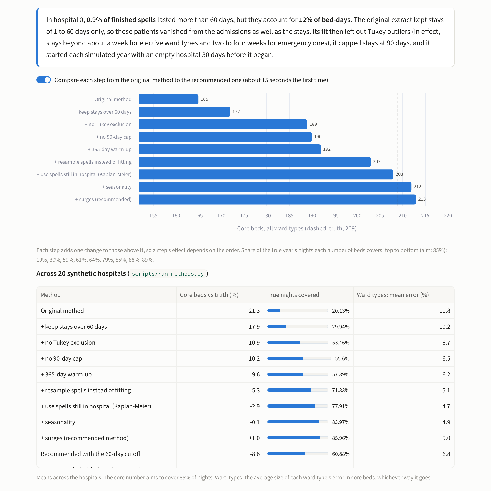
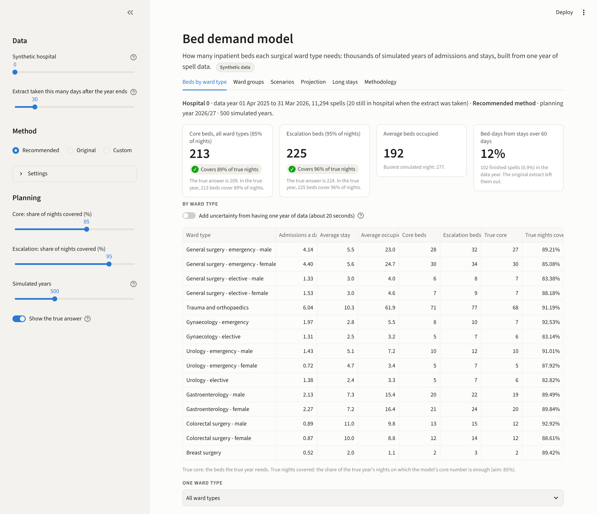

# Inpatient bed demand model

How many beds does each surgical ward type need next year, so that it has enough on 85% (or 95%) of nights? This model answers that from one year of inpatient spell data: it simulates thousands of years of admissions and lengths of stay and reads the bed numbers off the simulated occupancy. It also combines ward types that could share a ward, tests ways of reducing demand (shorter stays, same-day emergency care, day cases and others) and projects demand forward.

It is a from-scratch rebuild of a bed model I first wrote for NHS use, run on a **synthetic hospital** instead of real data. Because the process that generates the synthetic data is known, every bed number can be checked against the true answer, so the rebuild also measures which of the original method's choices matter and by how much.

**Live dashboard:** *(to be deployed on Streamlit Community Cloud)*

**All data here is synthetic.** See [Provenance](#provenance).

**Full methodology**, with every formula, assumption and check and worked examples: [docs/METHODOLOGY.md](docs/METHODOLOGY.md). It is also the *Methodology* tab in the dashboard.

## Findings

Across 20 synthetic hospitals, each with one observed year of about 11,000 spells and compared with the true requirement for the following year:

1. **The original method understates beds by about a fifth.** Its core number for the whole hospital is 21% below the true requirement (± 2%), and in the true year it is enough on only 20% of nights, not 85%. The rebuilt method is within 1% (± 2%) and is enough on 86% of nights; its escalation number on 95%, as intended.
2. **Losing long stays causes most of it.** Stays over 60 days are under 1% of spells but about 10% of bed-days. Of the 22-point gap between the two methods, 14 points come from changes that put long stays back: keeping stays over 60 days (3.4), dropping the Tukey outlier exclusion (7.0), using spells still in hospital (2.4), and removing the 90-day cap and the short warm-up (1.3). Resampling spells instead of fitting a distribution adds 4.3, and seasonality and emergency surges 3.9.
3. **Either trimming choice alone breaks an otherwise sound model.** Put the 60-day cutoff back into the rebuilt method and it is 9% short, enough on 61% of nights. Put the Tukey exclusion back and it is 21% short, enough on 20%.
INTERVAL_FINDING
5. **Adding up ward types overstates the hospital's need.** In hospital 0, the fifteen ward types' core numbers add up to 244 beds, but the hospital as a whole needs 213 on 85% of nights, because ward types aren't all busy at once.



Full tables: [`results/methods_summary.md`](results/methods_summary.md), [`results/intervals_summary.md`](results/intervals_summary.md), and section 8 of the [methodology](docs/METHODOLOGY.md#8-results-against-the-truth).



## What the model does

1. **Admissions.** For each ward type: admissions a day and a day-of-week pattern; shared across ward types of the same kind (emergency or elective), a seasonal pattern and, for emergency admissions, slowly wandering surges in demand. Each day's admissions are Poisson.
2. **Lengths of stay.** Every spell in the data year, including those still in hospital when the extract was taken (through Kaplan–Meier weights), resampled for each simulated patient. Each spell keeps its flags, so the scenarios act on individual patients.
3. **Simulation.** For each simulated year, occupancy each midnight is admissions so far minus discharges so far, computed for all simulated years at once. Each year starts from an empty hospital a year earlier, so the long stays are in place from the first night.
4. **Outputs.** Core and escalation beds as whole numbers, with the share of nights each covers; ranges from refitting the model to bootstrap copies of the data year; shared-ward groups; ten demand-reduction scenarios; a multi-year projection; and discharge targets.

## What changed from the original

| Original | Rebuild | Why |
|---|---|---|
| Spells over 60 days excluded from the extract | All spells kept | A stay of over 60 days holds a bed for over 60 nights. In the synthetic hospitals, stays over 60 days are under 1% of spells but 10% of bed-days (6–13% across hospitals) |
| Stays above Tukey's far fence (Q3 + 3 × IQR) left out of the fit | Kept | For skewed stays the fence cuts into the real tail: it falls at about a week for elective ward types and two to four weeks for emergency ones, and the few percent of spells beyond it hold a fifth to two-fifths of the bed-days |
| Finished spells only | Spells still in hospital used through Kaplan–Meier | An extract taken soon after the year ends misses the late admissions who are still in hospital, disproportionately the long stays |
| Five distributions fitted, the best chosen by the KS statistic | Spells resampled | Keeps the tail and each patient's flags; KS on whole days is distorted by ties |
| Day-of-week pattern only | Plus seasonality and emergency surges | Both widen the range of occupancy, which is what the 85th and 95th percentiles measure |
| 30-day warm-up, sampled stays capped at 90 days | 365-day warm-up, no cap | A short warm-up starts the year with too few long-stay patients in hospital |
| Interpolated (fractional) percentiles; Monte Carlo confidence intervals | Whole beds with the share of nights covered; ranges from bootstrapping the data year | A ward can't open 3.95 beds; Monte Carlo noise says nothing about how well one year of data describes the hospital |
| Scenarios as equivalent cuts in the admission rate or the average stay | Scenarios act on individual simulated patients | SDEC-eligible patients are 1–2 day stays. In hospital 0, treating 'SDEC takes all its eligible patients' as a 5% cut in admissions saves 8 core beds; removing those patients saves 3 |

**Is a 60-day cutoff ever justified?** Only when those patients are planned for separately, on a long-stay or complex-discharge ward sized from the same spells. For the beds a ward type needs in total, no: in the synthetic hospitals, putting the cutoff back into the otherwise recommended method understates core beds by about 9%.

The original method is available in full (dashboard: *Method → Original*), and every change can be switched on or off by itself (*Method → Custom*).

## The dashboard

[`app.py`](app.py), a Streamlit app.

- **Beds by ward type.** Core and escalation beds for each ward type and for the hospital, with the true answer alongside (possible only with synthetic data) and, on request, ranges from refitting to bootstrap copies of the data year. Occupancy through the year for any ward type, and its length-of-stay distribution against the model's.
- **Ward groups.** Beds for ward types sharing a ward against separate wards.
- **Scenarios.** Core beds saved by each demand-reduction scenario, by ward type, with discharge targets.
- **Projection.** Core and escalation beds over the coming years for chosen growth in admissions and improvement in length of stay.
- **Long stays.** For the selected hospital, the bed numbers from each step between the original method and the recommended one, against the truth; and the 20-hospital results.
- **Methodology.**

## Running it

```bash
pip install -r requirements.txt
streamlit run app.py
pip install pytest tabulate
python -m pytest                                    # 22 tests
python scripts/run_methods.py --hospitals 20         # methods against the truth (about 10 minutes)
python scripts/run_intervals.py --hospitals 20       # are the uncertainty ranges honest? (about 10 minutes)
```

## Layout

```
app.py                      Streamlit dashboard
src/bedmodel/
  synthetic.py              the synthetic hospital: ward types, admissions, stays, flags, the extract
  arrivals.py               admission rates, weekly pattern, seasonality, surges
  los.py                    lengths of stay: the original fit; the spell pool with Kaplan-Meier weights
  simulate.py               the occupancy engine
  metrics.py                whole beds, coverage, Monte Carlo intervals
  model.py                  methods, fitting, simulation, scenarios, projection, data bootstrap, truth
scripts/                    methods against the truth; uncertainty ranges against the truth
results/                    their outputs
docs/METHODOLOGY.md         full methodology (also the dashboard's Methodology tab)
tests/                      automated checks
```

## Provenance

Everything in this repository is synthetic or newly written. The original model was built for an NHS trust; none of its code, data, configuration, outputs or the names of its systems are included here. The ward types are generic surgical ward types, and every number describing them (admissions, stays, long-stay shares, scenario flags) is invented to be plausible. The results show how the method's choices behave on data whose true answer is known; they are not figures for any real hospital.

## Licence

MIT
